# NIJMITRA — Database ERD

PostgreSQL, snake_case names, `uuid` (v7) primary keys, `timestamptz` UTC timestamps, `numeric(18,2)` money.
Personal tables carry `user_id`, `created_at`, `updated_at`, `created_by`, `updated_by`, `is_deleted`, `deleted_at`.

```mermaid
erDiagram
    users ||--|| user_profiles : has
    users ||--|| user_security_settings : has
    users ||--o{ user_authenticator_secrets : enrolls
    users ||--o{ user_recovery_codes : owns
    users ||--o{ user_sessions : opens
    user_sessions ||--o{ refresh_tokens : rotates
    users ||--o{ user_devices : uses
    users ||--o{ login_audit_logs : generates
    users ||--o{ user_roles : assigned
    roles ||--o{ user_roles : grants
    roles ||--o{ role_permissions : includes
    permissions ||--o{ role_permissions : in

    users ||--o{ expense_categories : defines
    expense_categories ||--o{ expenses : classifies
    users ||--o{ income_records : earns
    users ||--o{ monthly_budgets : plans
    monthly_budgets ||--o{ budget_categories : splits
    users ||--o{ recurring_expenses : schedules
    recurring_expenses ||--o{ recurring_expense_occurrences : generates

    users ||--o{ document_folders : organises
    document_folders ||--o{ documents : contains
    documents ||--o{ document_versions : versions
    documents ||--o{ document_tags : tagged
    documents ||--o{ document_share_links : shared
    stored_files ||--o{ document_versions : stores

    users ||--o| password_vaults : unlocks
    users ||--o{ password_entries : saves
    password_entries ||--o{ password_history : keeps
    users ||--o{ secure_notes : writes

    users ||--o{ custom_tables : builds
    custom_tables ||--o{ custom_table_columns : defines
    custom_tables ||--o{ custom_table_records : holds
    custom_table_records ||--o{ custom_table_values : cells
    custom_table_records ||--o{ custom_table_attachments : files

    users ||--o{ product_registers : keeps
    product_registers ||--o{ product_custom_fields : extends
    product_registers ||--o{ products : lists

    users ||--o{ contact_groups : groups
    contact_groups ||--o{ contacts : members
    contacts ||--o{ contact_attachments : files
    contacts ||--o{ credit_transactions : party
    credit_transactions ||--o{ credit_payments : settles
    credit_transactions ||--o{ credit_reminders : reminds

    users ||--o{ diary_entries : journals
    diary_entries ||--o{ diary_tags : tagged
    diary_entries ||--o{ diary_attachments : photos
    users ||--o{ calendar_events : schedules
    users ||--o{ reminders : sets
    calendar_events ||--o{ reminder_schedules : planned

    users ||--o{ notifications : receives
    users ||--|| notification_preferences : prefers
    notification_policies ||--o{ notification_templates : uses
    users ||--o{ notification_queue : queued
    users ||--o{ push_subscriptions : devices
    communication_providers ||--o{ communication_logs : delivers

    users ||--o{ friend_requests : sends
    users ||--o{ friend_connections : befriends
    chat_conversations ||--o{ chat_participants : has
    chat_conversations ||--o{ chat_messages : contains
    chat_messages ||--o{ chat_attachments : carries
    users ||--|| user_presences : presence
    users ||--o{ blocked_users : blocks
```

See [DATABASE_DESIGN.md](DATABASE_DESIGN.md) for column-level details, indexes and constraints.
